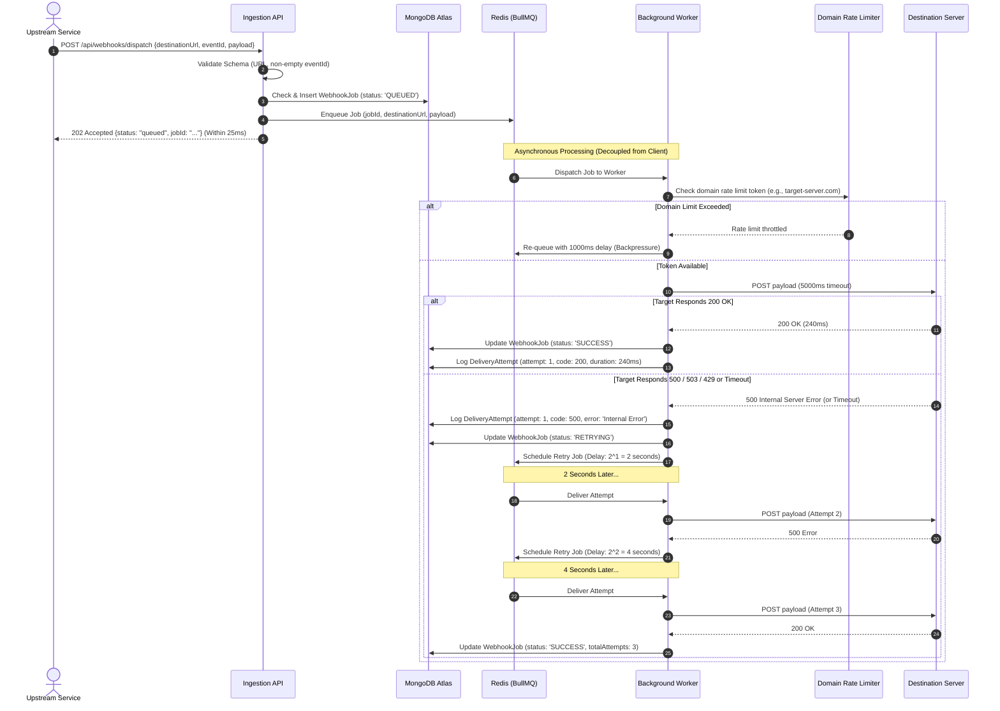

# System Architecture & Technical Specification
## Distributed, Fault-Tolerant Webhook Dispatcher Engine

---

## 1. Executive Summary & Problem Statement

In modern distributed microservice and event-driven architectures, services need to broadcast state-change notifications (webhooks) to third-party endpoints reliably. 

### The Core Challenges:
1. **Downstream Unreliability:** Destination client servers can crash, suffer network partitions, experience downtime, or respond with heavy latency (e.g., 5–15 seconds).
2. **Blocking Cascades:** If the emitting service makes synchronous HTTP calls to external destinations, worker threads become blocked, causing resource starvation, high memory pressure, and cascading API outages.
3. **Thundering Herd & Rate-Limit Flooding:** Blindly blasting thousands of webhook events at a single destination domain can overwhelm their servers or trigger `429 Too Many Requests` bans.
4. **Non-Negotiable Guarantees:** A production-grade dispatcher must guarantee **at-least-once delivery**, **zero-latency ingestion (<30ms)**, **exponential backoff with jitter**, **per-destination domain rate limits**, and a **tamper-proof delivery audit trail**.

This document outlines the architectural blueprint, design choices, data models, and failure modes implemented in this engine.

---

## 2. High-Level System Architecture

```mermaid
flowchart TD
    subgraph ClientLayer["Clients & Upstream Services"]
        P1["Internal Microservice / Client"]
        Dashboard["React Observability Dashboard"]
    end

    subgraph IngestionLayer["Ingestion API (Express.js)"]
        API["POST /api/webhooks/dispatch"]
        Validator["Payload Schema Validation (Zod)"]
        Idempotency["Idempotency Gatekeeper (Unique eventId)"]
        MongoJobInit["Insert Initial Job (Status: QUEUED)"]
    end

    subgraph QueueLayer["Asynchronous Message Broker (Redis + BullMQ)"]
        ActiveQueue["Ready Queue (FIFO)"]
        DelayedQueue["Delayed / Backoff ZSET (Timestamp-based)"]
        DLQ["Dead Letter Queue (Permanently Failed)"]
    end

    subgraph WorkerLayer["Distributed Background Workers"]
        WorkerPool["Worker Process Pool"]
        DomainLimiter["Per-Domain Rate Limiter (Redis Token Bucket)"]
        HttpDispatcher["HTTP Dispatcher (Axios with 5s Hard Timeout)"]
        ErrorClassifier["Error Classifier (Transient vs Permanent)"]
    end

    subgraph DownstreamDestinations["Target Webhook Endpoints"]
        TargetA["Customer Webhook Server (200 OK)"]
        TargetB["Flaky Endpoint (5xx / Timeout)"]
        MockServer["Built-in Mock Receiver (/api/mock-receiver)"]
    end

    subgraph PersistenceLayer["Audit & Observability (MongoDB Atlas)"]
        JobsCollection[("webhook_jobs Collection")]
        LogsCollection[("delivery_attempts Collection")]
    end

    %% Flow
    P1 -->|1. POST Dispatch| API
    API --> Validator
    Validator --> Idempotency
    Idempotency --> MongoJobInit
    MongoJobInit -->|Write Initial State| JobsCollection
    Idempotency -->|2. Enqueue Job| ActiveQueue
    API -.->|3. Return 202 Accepted {jobId} < 30ms| P1

    ActiveQueue -->|4. Pull Job| WorkerPool
    WorkerPool --> DomainLimiter
    DomainLimiter -->|Pass Token| HttpDispatcher
    DomainLimiter -->|Quota Exceeded| DelayedQueue
    
    HttpDispatcher -->|5. HTTP POST| TargetA
    HttpDispatcher -->|5. HTTP POST| TargetB
    HttpDispatcher -->|5. HTTP POST| MockServer

    TargetA -->|2xx Success| ErrorClassifier
    TargetB -->|5xx / 429 / Timeout| ErrorClassifier

    ErrorClassifier -->|Success| JobsCollection
    ErrorClassifier -->|Log Attempt| LogsCollection

    ErrorClassifier -->|Retry with Exponential Backoff| DelayedQueue
    DelayedQueue -->|Delay Expired (2s, 4s, 8s)| ActiveQueue
    ErrorClassifier -->|Max Retries (3) Exhausted| DLQ
    DLQ -->|Mark FAILED| JobsCollection

    Dashboard -->|Query Real-time Status & Telemetry| API
    API -->|Read| JobsCollection
    API -->|Read| LogsCollection
```

---

## 3. End-to-End Sequence of Operations



---

## 4. Key Architectural Pillars & Justifications

### 4.1 Ingestion Layer: Ultra-Fast & Non-Blocking
* **HTTP Status Code `202 Accepted`:** The HTTP RFC standard explicitly defines `202 Accepted` for asynchronous batch/queue processing where the request is validated and scheduled, but downstream execution is deferred.
* **Response Time < 30ms:** The ingestion handler performs only lightweight validation, inserts a lightweight metadata document in MongoDB, pushes the job ID to Redis, and returns immediately.
* **Idempotency via `eventId`:** Prevents accidental double-dispatch if an upstream service retries an ingestion call due to a temporary network drop. If an `eventId` already exists in MongoDB, the engine returns the existing `jobId` with HTTP 200/202 instead of duplicating the queue message.

### 4.2 Queue & Scheduling Engine: Why Redis + BullMQ?
* **Why not MongoDB as a queue?**
  * Polling MongoDB (`db.jobs.find({ status: 'QUEUED' })`) produces high CPU usage, index lock contention, and introduces polling lag.
  * In contrast, **Redis Sorted Sets (`ZSET`)** store delayed timestamps as scores with $O(\log N)$ insertion and instantaneous atomic pop operations.
* **Reliability & Worker Crash Recovery:**
  * BullMQ utilizes Redis atomic Lua scripts. If a worker process abruptly dies or crashes mid-dispatch, Redis returns the stalled job to the queue automatically (At-Least-Once delivery guarantee).

### 4.3 Resilience & Exponential Backoff Strategy
Downstream failures fall into two distinct categories:

| Error Type | Status Codes / Errors | Action Taken | Architectural Justification |
| :--- | :--- | :--- | :--- |
| **Permanent Errors** | `400 Bad Request`<br>`401 Unauthorized`<br>`403 Forbidden`<br>`404 Not Found`<br>`422 Unprocessable` | **Mark FAILED immediately (No Retries)** | The client endpoint explicitly rejected the request format, authentication, or path. Retrying will never succeed and only wastes network and compute bandwidth. |
| **Transient Errors** | `500 Internal Error`<br>`502 Bad Gateway`<br>`503 Unavailable`<br>`504 Gateway Timeout`<br>`429 Rate Limited`<br>`ETIMEDOUT / ECONNREFUSED` | **Retry with Exponential Backoff + Jitter** | The destination is temporarily down, restarting, or rate-limiting. Backing off allows the downstream server time to recover. |

#### Exponential Backoff Formula:
$$\text{Delay}(n) = \text{BaseDelay} \times 2^{(n - 1)} + \text{jitter}$$
* **Attempt 1 Failure:** Wait $2 \times 2^0 = 2\text{ seconds}$
* **Attempt 2 Failure:** Wait $2 \times 2^1 = 4\text{ seconds}$
* **Attempt 3 Failure:** Wait $2 \times 2^2 = 8\text{ seconds}$
* **Attempt 4 (Exhausted):** Sent to Dead Letter Queue (DLQ), Job marked permanently as `FAILED`.

### 4.4 Per-Destination Domain Rate Limiting
* **The Problem:** If 1,000 webhooks are destined for `https://api.client.com/webhooks`, dispatching all 1,000 concurrently would act as an unintended Distributed Denial of Service (DDoS) against the client.
* **The Solution (Sliding Window / Token Bucket in Redis):**
  * We extract the hostname (e.g., `api.client.com`) from `destinationUrl`.
  * Maintain a Redis key: `ratelimit:domain:<domain_name>`.
  * Enforce a configurable threshold (e.g., **5 requests per second per domain**).
  * If the limit for that domain is reached, the worker does **not** discard the event; instead, it postpones and reschedules the job with a 1-second delay, implementing graceful backpressure.

---

## 5. Data Modeling & Database Schema (MongoDB Atlas)

### 5.1 `webhook_jobs` Collection
Stores the lifecycle state and payload of every dispatched webhook.

```javascript
{
  "_id": ObjectId("673f..."),
  "jobId": "wh_job_9f8b2c4e1a",          // Unique internal UUID
  "eventId": "evt_signup_109283",        // Client-supplied idempotency key (Indexed Unique)
  "destinationUrl": "https://api.customer.com/webhook",
  "domain": "api.customer.com",          // Extracted domain for indexing & rate-limiting
  "payload": {                           // Arbitrary JSON payload
    "event": "user.signup",
    "userId": "usr_999",
    "timestamp": 1732200000
  },
  "status": "SUCCESS",                   // Enum: QUEUED, PROCESSING, RETRYING, SUCCESS, FAILED
  "currentAttempt": 3,
  "maxRetries": 3,
  "createdAt": ISODate("2026-11-21T19:00:00Z"),
  "updatedAt": ISODate("2026-11-21T19:00:14Z"),
  "lastError": null
}
```

### 5.2 `delivery_attempts` Collection (Audit Trail)
Stores an append-only audit record for every single HTTP invocation made by workers.

```javascript
{
  "_id": ObjectId("673f..."),
  "jobId": "wh_job_9f8b2c4e1a",          // Reference to parent job
  "attemptNumber": 1,                    // 1, 2, 3
  "httpStatus": 500,                     // HTTP response code (0 if network timeout)
  "durationMs": 342,                     // Roundtrip execution latency
  "requestHeaders": { ... },
  "responseBody": "Internal Server Error: Database Connection Pool Exhausted",
  "errorMessage": null,
  "timestamp": ISODate("2026-11-21T19:00:02Z")
}
```

---

## 6. Built-in Mock Receiver Suite (`/api/mock-receiver`)

To allow zero-friction verification during interviews and live demos without needing external mock tools (like webhook.site), the server exposes an intelligent Mock Receiver:
* `POST /api/mock-receiver?status=200`: Always responds with 200 OK.
* `POST /api/mock-receiver?status=500`: Simulates server failure (triggers retries).
* `POST /api/mock-receiver?status=429`: Simulates rate-limit rejection (triggers retries).
* `POST /api/mock-receiver?delay=6000`: Simulates network timeout (exceeds 5000ms client timeout).
* `POST /api/mock-receiver?failUntil=2&code=500`: Fails the first 2 attempts with HTTP 500, then returns 200 OK on attempt 3. Perfect for demonstrating exponential backoff live!

---

## 7. Observability Dashboard (React + Tailwind CSS)

The React web interface delivers real-time visibility into the distributed engine:
1. **Real-time Metrics:** Active throughput, total queued, success rate, retry rate, and dead-letter count.
2. **Interactive Dispatcher Form:** Allows manual submission of sample webhooks with one click.
3. **Delivery Timeline Inspector:** Clicking any job reveals the detailed execution timeline showing exact timestamps, backoff intervals, response headers, and HTTP status codes for each attempt.
4. **Mock Simulator Control Panel:** One-click presets for testing success, failure, timeout, and recovery flows.

---

## 8. Summary of Interview Talking Points

1. **Decoupled Architecture:** Ingestion never waits for dispatch; throughput is constrained only by Redis memory and Node.js network sockets.
2. **Exponential Backoff with Jitter:** Protects downstream partners from thundering herd and cascading failure loops.
3. **Per-Domain Rate Limiting:** Guarantees multi-tenant fairness and prevents single-domain flooding.
4. **Resilient Persistence:** Every attempt is durably recorded in MongoDB for compliance, debugging, and auditing.
5. **Observability-First:** Real-time metrics and a visual timeline turn complex distributed behaviors into clear, testable workflows.
