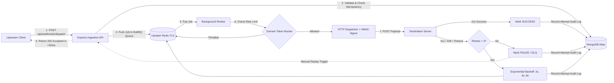

# Distributed, Fault-Tolerant Webhook Dispatcher Engine

[](https://nodejs.org/)
[](https://expressjs.com/)
[](https://www.mongodb.com/)
[](https://upstash.com/)
[](https://react.dev/)
[](https://tailwindcss.com/)
[](LICENSE)

A production-grade, distributed webhook delivery engine built on the **MERN** stack and **Upstash Redis BullMQ**. Engineered to broadcast event notifications reliably to external third-party endpoints with **sub-30ms non-blocking ingestion**, **exponential backoff retries (2s, 4s, 8s)**, **per-destination domain rate limiting (Token Bucket)**, **cryptographic HMAC-SHA256 signatures**, and **manual Dead-Letter Queue (DLQ) replay recovery**.

---

## Table of Contents
- [1. Executive Summary & Capabilities](#1-executive-summary--capabilities)
- [2. System Architecture](#2-system-architecture)
- [3. Core Architectural Choices & Trade-offs](#3-core-architectural-choices--trade-offs)
- [4. API Reference & Sample cURL Commands](#4-api-reference--sample-curl-commands)
- [5. Security: HMAC-SHA256 Signature Verification](#5-security-hmac-sha256-signature-verification)
- [6. Built-in Mock Receiver Suite](#6-built-in-mock-receiver-suite)
- [7. Local Setup & Quickstart](#7-local-setup--quickstart)
- [8. Step-by-Step Render Deployment Guide](#8-step-by-step-render-deployment-guide)
- [9. Automated End-to-End Testing (Playwright & Selenium)](#9-automated-end-to-end-testing-playwright--selenium)
- [10. Repository Structure](#10-repository-structure)

---

## 1. Executive Summary & Capabilities

- **Lightning-Fast Non-Blocking Ingestion:** Returns `202 Accepted` (`< 30ms`) with a unique `jobId`, strictly decoupling caller acceptance from downstream external target latency.
- **Asynchronous Distributed Worker Pool:** Queued jobs are persisted in MongoDB Atlas and pushed into Upstash Redis BullMQ, where an isolated worker process handles background dispatch.
- **Intelligent Retry Logic with Exponential Backoff ($2^n$):**
  - Transient failures (`5xx`, `429 Too Many Requests`, and connection timeouts) trigger automatic retries scheduled exponentially: **Attempt 1 $\rightarrow$ 2s delay, Attempt 2 $\rightarrow$ 4s delay, Attempt 3 $\rightarrow$ 8s delay**.
  - Permanent client errors (`4xx`) fail fast without wasting retries or computing bandwidth.
- **Per-Destination Domain Rate Limiting (Token Bucket):** Enforces an in-memory Redis sliding-window limit (default **5 req/sec per target domain**). Burst traffic is queued without crashing external customer endpoints.
- **Manual DLQ Replay / Re-dispatch:** Failed jobs that exhaust retries are stored in Dead-Letter status and can be re-queued with 1 click via `POST /api/webhooks/jobs/:jobId/retry`.
- **Cryptographic Payload Signing:** Every payload is signed via HMAC-SHA256 with timestamp (`X-Webhook-Signature`, `X-Webhook-Timestamp`) to prevent tampering and replay attacks.
- **Compliance Audit Trail & 1-Click Export:** Complete attempt history (HTTP status, latency in ms, request headers, error messages) with 1-click **CSV** and **JSON** export.
- **Idempotency Defense:** Client-supplied `eventId` prevents duplicate dispatches during network retries.

---

## 2. System Architecture

For a comprehensive technical specification, failure matrix, and sequence diagrams, see [ARCHITECTURE.md](file:///d:/Distributed%20Webhook%20Dispatcher/ARCHITECTURE.md).



---

## 3. Core Architectural Choices & Trade-offs

| Decision | Choice Made | Why This Approach? | Alternative Rejected & Trade-off |
| :--- | :--- | :--- | :--- |
| **Ingestion Protocol** | `202 Accepted` + async worker | Decouples caller API latency from external network variability. Upstream callers never wait for external servers. | Synchronous dispatch: Slow targets (5–10s latency) exhaust server thread pools and cause cascading timeouts. |
| **Message Broker** | Upstash Redis + BullMQ | Atomic $O(\log N)$ sorted sets (`ZSET`) for delayed exponential backoff scheduling with microsecond latency. | MongoDB polling (`find({ status: 'QUEUED' })`): High CPU load, index lock contention, and polling delay. |
| **State Persistence** | MongoDB Atlas (Mongoose) | Flexible BSON document schema cleanly handles arbitrary, polymorphic JSON webhook payloads without schema migrations. | Relational SQL: Webhook payloads vary per event type; rigid schemas require stringified JSON columns. |
| **Rate Limiter** | Redis Token Bucket per domain | Throttles per target hostname (5 req/s) so one partner receiving heavy traffic never blocks traffic to other domains. | Global rate limiter: Throttles all outgoing traffic even when other partner domains are completely idle. |
| **Hard Timeout** | 5000ms client-side abort | Aborts non-responsive external sockets to prevent zombie thread leaks and socket starvation. | Indefinite timeout: A few slow targets would exhaust system socket limits. |
| **Security Signing** | HMAC-SHA256 (`t=...,v1=...`) | Industry standard (Stripe/GitHub) preventing payload tampering and replay attacks. | Plain HTTP without signatures: Vulnerable to man-in-the-middle payload alteration. |

---

## 4. API Reference & Sample cURL Commands

### 1. Ingestion Endpoint: Dispatch Webhook
Queues an event payload for background delivery and returns `202 Accepted` in `<30ms`.

```bash
curl -X POST http://localhost:5000/api/webhooks/dispatch \
  -H "Content-Type: application/json" \
  -d '{
    "destinationUrl": "http://localhost:5000/api/mock-receiver?status=200",
    "eventId": "evt_test_1001",
    "payload": {
      "event": "user.signup",
      "userId": "usr_999",
      "email": "alex.morgan@company.io",
      "tier": "enterprise"
    }
  }'
```

**Response (HTTP 202 Accepted):**
```json
{
  "status": "queued",
  "jobId": "wh_job_a1b2c3d4e5",
  "eventId": "evt_test_1001",
  "message": "Webhook queued for asynchronous background delivery",
  "createdAt": "2026-11-21T17:00:00.000Z"
}
```

---

### 2. Query Job Status & Full Audit History
Fetches real-time status and attempt logs for any `jobId`.

```bash
curl -X GET http://localhost:5000/api/webhooks/jobs/wh_job_a1b2c3d4e5
```

**Response:**
```json
{
  "success": true,
  "job": {
    "jobId": "wh_job_a1b2c3d4e5",
    "eventId": "evt_test_1001",
    "destinationUrl": "http://localhost:5000/api/mock-receiver?status=200",
    "domain": "localhost",
    "status": "SUCCESS",
    "currentAttempt": 1,
    "maxRetries": 3,
    "lastStatusCode": 200
  },
  "attempts": [
    {
      "attemptNumber": 1,
      "httpStatus": 200,
      "durationMs": 48,
      "requestHeaders": {
        "X-Webhook-Signature": "t=1732210800,v1=4f5d6a...",
        "X-Webhook-Timestamp": "1732210800"
      },
      "responseBody": "{\"status\":200,\"mock\":true}",
      "errorMessage": null
    }
  ]
}
```

---

### 3. List Jobs (with Pagination, Status Filter & Search)
Filter by status (`ALL`, `SUCCESS`, `RETRYING`, `FAILED`, `QUEUED`) or search by `jobId`, `eventId`, or `domain`:

```bash
curl -X GET "http://localhost:5000/api/webhooks/jobs?status=FAILED&search=user.signup&page=1&limit=20"
```

---

### 4. Manual DLQ Replay / Re-dispatch
Re-queues a failed or dead-letter webhook for immediate background re-delivery:

```bash
curl -X POST http://localhost:5000/api/webhooks/jobs/wh_job_a1b2c3d4e5/retry
```

**Response:**
```json
{
  "success": true,
  "message": "Webhook job wh_job_a1b2c3d4e5 successfully re-queued for delivery"
}
```

---

### 5. System Health & Telemetry Metrics
```bash
curl -X GET http://localhost:5000/api/stats
```

---

## 5. Security: HMAC-SHA256 Signature Verification

Every outgoing HTTP dispatch includes tamper-proofing headers:
- `X-Webhook-Signature`: `t=<timestamp>,v1=<hmac_hex_hash>`
- `X-Webhook-Timestamp`: Unix epoch seconds
- `X-Webhook-ID`: Internal Job ID
- `X-Webhook-Event`: Caller's Idempotency Key

### Verification Example (Node.js receiver):
```javascript
import crypto from 'crypto';

function verifySignature(rawPayload, headerSignature, secret) {
  const [tPart, v1Part] = headerSignature.split(',');
  const timestamp = tPart.split('=')[1];
  const signature = v1Part.split('=')[1];

  const expected = crypto
    .createHmac('sha256', secret)
    .update(`${timestamp}.${JSON.stringify(rawPayload)}`)
    .digest('hex');

  return crypto.timingSafeEqual(Buffer.from(signature), Buffer.from(expected));
}
```

---

## 6. Built-in Mock Receiver Suite

Test retries, backoff, and timeouts without external dependencies via `/api/mock-receiver`:

| Scenario | Target URL | Expected Engine Behavior |
|:---|:---|:---|
| **Instant Success (200 OK)** | `/api/mock-receiver?status=200` | Delivered on Attempt #1 in ~50ms. |
| **Self-Healing Flaky Server** | `/api/mock-receiver?failUntil=2&code=500` | Fails Attempt 1 $\rightarrow$ waits 2s $\rightarrow$ Fails Attempt 2 $\rightarrow$ waits 4s $\rightarrow$ Succeeds on Attempt 3. |
| **Permanent 500 (DLQ)** | `/api/mock-receiver?status=500` | Fails Attempts 1, 2, 3 (waits 2s, 4s, 8s) $\rightarrow$ moves to `FAILED` (DLQ). |
| **Downstream 429 Throttle** | `/api/mock-receiver?status=429` | Treated as transient error; retried with exponential backoff. |
| **Hard Timeout (5000ms)** | `/api/mock-receiver?delay=6500` | Aborted at 5000ms threshold; scheduled for retry. |
| **Rapid Fire Burst (8 Jobs)** | 8 concurrent jobs to same domain | Token bucket limits to 5 req/s; remaining 3 delayed to protect destination. |

---

## 7. Local Setup & Quickstart

### Prerequisites
- [Node.js](https://nodejs.org/) (v18.x or v20.x+)
- [MongoDB](https://www.mongodb.com/) (Atlas URI or local instance)
- [Redis](https://redis.io/) (Upstash Redis TLS or local Redis)

### 1. Clone & Configure
```bash
git clone https://github.com/aryacreations/Distributed-fault-tolerent-webhook-description-engine.git
cd Distributed-fault-tolerent-webhook-description-engine

# Copy environment variables template:
cp server/.env.example server/.env
```

Populate `server/.env`:
```env
PORT=5000
NODE_ENV=development
MONGODB_URI=mongodb+srv://<user>:<password>@cluster0.mongodb.net/webhook_dispatcher?retryWrites=true&w=majority
REDIS_URL=rediss://default:<token>@bursting-tortoise-138365.upstash.io:6379
RATE_LIMIT_PER_SECOND_PER_DOMAIN=5
DISPATCH_TIMEOUT_MS=5000
MAX_RETRIES=3
WEBHOOK_SECRET=whsec_prod_dispatcher_secret_key_2026
```

### 2. Install & Start Concurrently
```bash
# Install root, backend, and frontend dependencies:
npm run install:all

# Launch backend (port 5000) and frontend (port 5173):
npm run dev
```

- **Frontend Dashboard:** `http://localhost:5173`
- **Backend API:** `http://localhost:5000`

---

## 8. Step-by-Step Render Deployment Guide

Both backend and frontend can be hosted for **free** on [Render.com](https://render.com/).

### Part 1: Deploy Backend (Web Service)
1. In Render, click **New +** $\rightarrow$ **Web Service**.
2. Connect repository: `aryacreations/Distributed-fault-tolerent-webhook-description-engine`.
3. Fill in configuration:
   - **Name:** `webhook-dispatcher-backend`
   - **Root Directory:** `server`
   - **Runtime:** `Node`
   - **Build Command:** `npm install`
   - **Start Command:** `node src/server.js`
   - **Instance Type:** `Free`
4. Add Environment Variables:
   - `NODE_ENV`: `production`
   - `MONGODB_URI`: `<your-mongodb-atlas-uri>`
   - `REDIS_URL`: `<your-upstash-redis-tls-url>`
   - `RATE_LIMIT_PER_SECOND_PER_DOMAIN`: `5`
   - `DISPATCH_TIMEOUT_MS`: `5000`
   - `MAX_RETRIES`: `3`
   - `WEBHOOK_SECRET`: `whsec_prod_dispatcher_secret_key_2026`
5. Click **Deploy Web Service** and copy the live URL (e.g. `https://webhook-dispatcher-backend.onrender.com`).

### Part 2: Deploy Frontend (Static Site)
1. In Render, click **New +** $\rightarrow$ **Static Site**.
2. Select the same repository.
3. Fill in configuration:
   - **Name:** `webhook-dispatcher-dashboard`
   - **Root Directory:** `client`
   - **Build Command:** `npm install && npm run build`
   - **Publish Directory:** `dist`
4. Add Environment Variable:
   - `VITE_API_URL`: `<your-backend-live-url>` (from Part 1)
5. Add SPA Rewrite Rule under **Redirects/Rewrites**:
   - **Type:** `Rewrite`
   - **Source:** `/*`
   - **Destination:** `/index.html`
6. Click **Create Static Site**.

---

## 9. Automated End-to-End Testing (Playwright & Selenium)

Every interactive UI element contains dedicated `data-testid` and `id` attributes for reliable cursor and test automation:

| Component | `data-testid` | Action |
|:---|:---|:---|
| **Navigation** | `nav-tab-overview`, `nav-tab-dispatch`, `nav-tab-simulator`, `nav-tab-deliveries`, `nav-tab-architecture` | Tab navigation |
| **Dispatch Studio** | `input-destination-url`, `input-event-id`, `textarea-payload`, `btn-dispatch-submit` | Form submission |
| **Payload Presets** | `btn-tpl-signup`, `btn-tpl-payment`, `btn-tpl-order`, `btn-tpl-subscription` | 1-click templates |
| **Testing Lab** | `btn-scenario-success`, `btn-scenario-recovering`, `btn-scenario-dlq`, `btn-scenario-timeout` | Trigger failure modes |
| **Audit Logs** | `input-search-jobs`, `filter-tab-SUCCESS`, `filter-tab-ALL`, `btn-export-csv`, `btn-export-json` | Search & export logs |
| **DLQ Replay** | `btn-replay-job`, `btn-quick-replay` | Re-queue failed webhooks |

### Running the Scripts:
```bash
# Playwright End-to-End Suite:
npm run test:playwright

# Selenium (Python) Cursor & Hover Suite:
npm run test:selenium
```

---

## 10. Repository Structure

```text
├── ARCHITECTURE.md          # In-depth Architecture, Failure Matrices, Sequence Diagrams
├── README.md                # Comprehensive documentation & execution guide
├── render.yaml              # Render infrastructure blueprint configuration
├── package.json             # Root workspace management
├── tests/
│   ├── e2e-playwright.js    # Playwright browser automation suite
│   └── e2e-selenium.py      # Selenium Python cursor & ActionChains suite
├── server/
│   ├── .env.example         # Template for environment variables
│   ├── package.json         # Backend dependencies & scripts
│   └── src/
│       ├── config/          # MongoDB Atlas & Upstash Redis TLS clients
│       ├── controllers/     # Ingestion, Replay, Job Queries, and Mock Endpoints
│       ├── middlewares/     # Zod schema validation & error handlers
│       ├── models/          # WebhookJob & DeliveryAttempt Mongoose schemas
│       ├── queues/          # BullMQ queue initialization
│       ├── routes/          # Express REST API routes
│       ├── services/        # Dispatcher HTTP client, HMAC Signer, Rate Limiter
│       ├── workers/         # Background dispatch worker with exponential backoff
│       ├── app.js           # Express setup & CORS configuration
│       └── server.js        # Server bootstrap & graceful shutdown
└── client/
    ├── package.json         # Frontend dependencies & scripts
    ├── vite.config.js       # Vite bundler configuration
    ├── tailwind.config.js   # Tailwind light glassmorphism styling
    └── src/
        ├── components/      # UI components (Header, Sidebar, JobDetailModal)
        ├── services/        # Axios API client
        ├── views/           # Overview, Dispatch Studio, Simulator, Logs, Architecture
        └── App.jsx          # Dashboard root component
```

---

## License
Distributed under the MIT License. Built with precision for the Backend Developer Take-Home Assignment.
