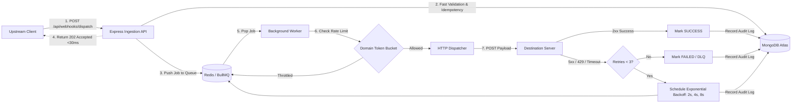

# Distributed, Fault-Tolerant Webhook Dispatcher Engine

[](https://nodejs.org/)
[](https://expressjs.com/)
[](https://www.mongodb.com/)
[](https://upstash.com/)
[](https://react.dev/)
[](https://tailwindcss.com/)
[](LICENSE)

A production-grade, distributed webhook delivery engine built on the **MERN** stack and **Redis**. Designed to reliably broadcast event notifications to external third-party endpoints with **sub-30ms non-blocking ingestion**, **exponential backoff retries (2s, 4s, 8s)**, **per-destination domain rate limiting (Token Bucket)**, and a **complete delivery audit trail**.

---

## Table of Contents
- [1. Key Features](#1-key-features)
- [2. System Architecture](#2-system-architecture)
- [3. Architectural Choices & Trade-offs](#3-architectural-choices--trade-offs)
- [4. API Reference & Sample cURL Commands](#4-api-reference--sample-curl-commands)
- [5. Built-in Mock Receiver Suite](#5-built-in-mock-receiver-suite)
- [6. Local Setup & Quickstart](#6-local-setup--quickstart)
- [7. Production Deployment (Free-Tier Guide)](#7-production-deployment-free-tier-guide)
- [8. Repository Structure](#8-repository-structure)

---

## 1. Key Features

- **Lightning-Fast Non-Blocking Ingestion:** Responds immediately with `202 Accepted` (`< 30ms`) with a unique `jobId`, never blocking on downstream HTTP latency.
- **Asynchronous Distributed Worker Pool:** Queued jobs are picked up in the background and dispatched via an isolated worker process powered by Redis.
- **Intelligent Retry Mechanism with Exponential Backoff:**
  - Transient errors (`5xx`, `429 Too Many Requests`, and network timeouts) trigger automatic retries scheduled with exponential backoff: **Attempt 1 $\rightarrow$ 2s delay, Attempt 2 $\rightarrow$ 4s delay, Attempt 3 $\rightarrow$ 8s delay**.
  - Permanent client errors (`400`, `401`, `404`, `422`) fail fast without wasting bandwidth or compute.
- **Per-Destination Domain Rate Limiting:** Enforces strict outbound limits (e.g., 5 req/sec per domain) via an in-memory Redis sliding-window/token-bucket algorithm, protecting client servers from sudden traffic spikes.
- **Immutable Delivery Audit Trail:** Every single dispatch attempt (HTTP status code, response time in milliseconds, error messages, and payload) is recorded in MongoDB for auditing.
- **Idempotency Gatekeeper:** Uses client-supplied `eventId` to prevent duplicate dispatches during network hiccups.
- **Interactive React Observability Dashboard:** Real-time visual monitoring of queued jobs, dispatch timelines, retry attempts, and system health metrics.

---

## 2. System Architecture

For a comprehensive deep-dive into the architectural design, failure matrices, and sequence diagrams, refer to [ARCHITECTURE.md](file:///d:/Distributed%20Webhook%20Dispatcher/ARCHITECTURE.md).



---

## 3. Architectural Choices & Trade-offs

| Decision | Choice Made | Why This Approach? | Alternative Rejected & Trade-off |
| :--- | :--- | :--- | :--- |
| **Ingestion Protocol** | `202 Accepted` + async worker | Decouples upstream services from downstream network variability; caller gets instant response regardless of target server latency. | Synchronous delivery: Slow downstream targets (e.g. 5–10s latency) exhaust server thread pools and cause cascading timeouts. |
| **Message Broker** | Redis (`ioredis` / BullMQ) | Atomic $O(\log N)$ sorted sets for delayed jobs (exponential backoff) with microsecond latency and at-least-once delivery semantics. | MongoDB polling (`find({ status: 'QUEUED' })`): High CPU load, index lock contention, and polling interval latency. |
| **State Persistence** | MongoDB Atlas (Mongoose) | Flexible BSON document schema cleanly handles arbitrary, polymorphic JSON webhook payloads without schema migrations. | Relational SQL: Webhook payloads vary wildly per event type; rigid columns require clunky stringified JSON columns. |
| **Rate Limiter** | Redis Token Bucket per domain | Prevents thundering-herd problems against partner domains by throttling per destination hostname. | Global rate limiter: Throttles all outgoing traffic even when other partner domains are idle. |
| **Hard Timeout** | 5000ms via Axios client | Prevents zombie socket leaks when target servers hang without terminating connections. | Indefinite timeout: A few slow targets would quickly starve system socket pools. |

---

## 4. API Reference & Sample cURL Commands

### 1. Ingestion Endpoint: Dispatch Webhook
Accepts an event, validates the payload, queues it, and returns `202 Accepted` instantly.

```bash
curl -X POST http://localhost:5000/api/webhooks/dispatch \
  -H "Content-Type: application/json" \
  -d '{
    "destinationUrl": "https://httpbin.org/post",
    "eventId": "evt_test_1001",
    "payload": {
      "event": "user.signup",
      "userId": "usr_999",
      "email": "alex@example.com"
    }
  }'
```

**Response (HTTP 202 Accepted):**
```json
{
  "status": "queued",
  "jobId": "wh_job_a1b2c3d4e5",
  "eventId": "evt_test_1001",
  "message": "Webhook queued for asynchronous background delivery"
}
```

---

### 2. Query Job Status & Delivery Audit Trail
Fetches real-time status and historical execution attempts for any `jobId`.

```bash
curl -X GET http://localhost:5000/api/webhooks/jobs/wh_job_a1b2c3d4e5
```

**Sample Response:**
```json
{
  "success": true,
  "job": {
    "jobId": "wh_job_a1b2c3d4e5",
    "eventId": "evt_test_1001",
    "destinationUrl": "https://httpbin.org/post",
    "domain": "httpbin.org",
    "status": "SUCCESS",
    "currentAttempt": 1,
    "maxRetries": 3,
    "createdAt": "2026-11-21T14:00:00.000Z",
    "updatedAt": "2026-11-21T14:00:00.320Z"
  },
  "attempts": [
    {
      "attemptNumber": 1,
      "httpStatus": 200,
      "durationMs": 312,
      "errorMessage": null,
      "timestamp": "2026-11-21T14:00:00.315Z"
    }
  ]
}
```

---

### 3. List All Jobs (with Pagination & Filters)
```bash
curl -X GET "http://localhost:5000/api/webhooks/jobs?status=FAILED&page=1&limit=10"
```

---

### 4. System Health & Performance Statistics
```bash
curl -X GET http://localhost:5000/api/stats
```

---

## 5. Built-in Mock Receiver Suite

To test retries, exponential backoff, and timeouts without external third-party tools, the server includes an intelligent mock receiver:

| Test Scenario | Target URL | Expected Engine Behavior |
| :--- | :--- | :--- |
| **Instant Success** | `http://localhost:5000/api/mock-receiver?status=200` | Delivered on Attempt #1 with HTTP 200. |
| **Flaky Server (Recovering)** | `http://localhost:5000/api/mock-receiver?failUntil=2&code=500` | Fails Attempt 1 (500) $\rightarrow$ waits 2s $\rightarrow$ Fails Attempt 2 (500) $\rightarrow$ waits 4s $\rightarrow$ Succeeds Attempt 3 (200). |
| **Permanent 500 Failure** | `http://localhost:5000/api/mock-receiver?status=500` | Fails Attempts 1, 2, 3 with exponential backoff (2s, 4s, 8s), then moves to DLQ (`status: FAILED`). |
| **Rate Limited Server** | `http://localhost:5000/api/mock-receiver?status=429` | Server returns 429; worker treats as transient error and retries with backoff. |
| **Connection Timeout** | `http://localhost:5000/api/mock-receiver?delay=7000` | Server hangs for 7s; worker hits 5000ms hard timeout and schedules retry. |

---

## 6. Local Setup & Quickstart

### Prerequisites
- [Node.js](https://nodejs.org/) (v18.x or v20.x+)
- [MongoDB](https://www.mongodb.com/) (Local instance or free MongoDB Atlas URI)
- [Redis](https://redis.io/) (Local Redis or free [Upstash Redis](https://upstash.com/))

### 1. Clone the Repository
```bash
git clone https://github.com/aryacreations/Distributed-fault-tolerent-webhook-description-engine.git
cd Distributed-fault-tolerent-webhook-description-engine
```

### 2. Configure Environment Variables
Inside `server/`, copy `.env.example` to `.env`:
```bash
cp server/.env.example server/.env
```

Populate `server/.env` with your credentials:
```env
PORT=5000
NODE_ENV=development
MONGODB_URI=mongodb+srv://<username>:<password>@cluster0.mongodb.net/webhook_dispatcher?retryWrites=true&w=majority
REDIS_URL=rediss://default:<token>@bursting-tortoise-138365.upstash.io:6379
RATE_LIMIT_PER_SECOND_PER_DOMAIN=5
DISPATCH_TIMEOUT_MS=5000
```

### 3. Install Dependencies & Start
Install all dependencies for root, backend, and frontend:
```bash
# In the root directory:
npm run install:all

# Run backend and frontend concurrently:
npm run dev
```

- **Backend API:** `http://localhost:5000`
- **Frontend Dashboard:** `http://localhost:5173`

---

## 7. Production Deployment (Free-Tier Guide)

### 1. Backend on Render.com (or Railway)
1. Link your GitHub repository on [Render](https://render.com/).
2. Create a **Web Service**:
   - **Root Directory:** `server`
   - **Build Command:** `npm install`
   - **Start Command:** `node src/server.js`
3. Add Environment Variables:
   - `MONGODB_URI`: Your MongoDB Atlas URI.
   - `REDIS_URL`: Your Upstash Redis TLS connection string.
   - `NODE_ENV`: `production`

### 2. Frontend on Vercel / Render
1. Deploy `client/` to Vercel or as a Static Site on Render.
2. Set environment variable: `VITE_API_URL=https://your-backend-service.onrender.com`.

---

## 8. Repository Structure

```text
├── ARCHITECTURE.md          # Complete Technical Specification & Diagrams
├── README.md                # Project documentation & execution guide
├── package.json             # Root workspace management
├── .gitignore               # Ignored dependencies & secrets
├── server/
│   ├── .env.example         # Template for environment variables
│   ├── package.json         # Backend dependencies & scripts
│   └── src/
│       ├── config/          # MongoDB & Redis client configurations
│       ├── controllers/     # Ingestion, Job Queries, and Mock Endpoints
│       ├── middlewares/     # Zod schema validation & error handlers
│       ├── models/          # WebhookJob & DeliveryAttempt Mongoose schemas
│       ├── queues/          # BullMQ queue initialization
│       ├── routes/          # Express REST API routes
│       ├── services/        # Dispatcher HTTP client & Token Bucket Rate Limiter
│       ├── workers/         # Background dispatch worker with backoff logic
│       ├── app.js           # Express application setup
│       └── server.js        # Entrypoint (DB connection & worker launch)
└── client/
    ├── package.json         # Frontend dependencies & scripts
    ├── vite.config.js       # Vite bundler configuration
    ├── tailwind.config.js   # Tailwind styling configuration
    └── src/
        ├── components/      # UI widgets (JobsTable, TimelineModal, Metrics)
        ├── services/        # Axios API client
        └── App.jsx          # Dashboard root component
```

---

## License
Distributed under the MIT License. Built with precision for production reliability.
